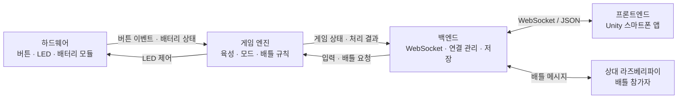

# 🐣 Raspberry Pi Tamagotchi

> 라즈베리파이 버튼으로 키우고, 스마트폰으로 확인하고, 친구와 배틀하는 다마고치 프로젝트

라즈베리파이 기반 조작기와 Unity 스마트폰 화면을 Wi-Fi로 연결하는 마이크로프로세서 팀 프로젝트입니다. 버튼 3개로 먹이 주기·놀아주기·잠자기를 수행하며, LED로 캐릭터 상태와 연결 상태를 확인합니다. 두 대의 라즈베리파이를 연결해 1:1 턴제 배틀과 통신 미니게임으로 확장하는 것을 목표로 합니다.

이 저장소의 개발 영역은 **프론트엔드, 백엔드, 게임 엔진, 하드웨어** 네 파트로 구분합니다. 아래 내용은 프로젝트의 설계와 개발 목표를 소개하며, 모든 기능의 구현 완료를 의미하지는 않습니다.

## 목차

- [프로젝트 개요](#프로젝트-개요)
- [주요 기능](#주요-기능)
- [시스템 구성](#시스템-구성)
- [파트별 역할](#파트별-역할)
- [입출력 및 통신 규격](#입출력-및-통신-규격)
- [하드웨어 구성](#하드웨어-구성)
- [개발 및 통합 순서](#개발-및-통합-순서)
- [팀 구성](#팀-구성)
- [개발 시 유의사항](#개발-시-유의사항)

## 프로젝트 개요

| 항목 | 내용 |
|---|---|
| 프로젝트 | 라즈베리파이 기반 대전형 다마고치 |
| 조작 | 물리 버튼 A·B·C |
| 게임 화면 | Unity 기반 스마트폰 앱 |
| 상태 표시 | 스마트폰 상태 바 및 LED 4개 |
| 통신 | 같은 Wi-Fi 내 WebSocket·JSON |
| 서버·게임 로직 | 라즈베리파이에서 실행 |
| 데이터 유지 | 캐릭터 상태를 JSON 파일로 주기적 저장 |
| 확장 목표 | 파이 간 1:1 배틀·통신 미니게임 |

GPIO 입출력, 이벤트 처리, 타이머, 네트워크 통신을 하나의 게임에 적용하고, 하드웨어와 소프트웨어를 파트별로 개발한 뒤 통합하는 것이 목표입니다.

## 주요 기능

### 캐릭터 육성

- **먹이 주기**: 포만감 회복
- **놀아주기**: 행복도 관리
- **잠자기·깨우기**: 수면 상태 전환 및 에너지 회복
- **시간 경과 처리**: 엔진의 주기적 업데이트로 캐릭터 상태 변경
- **상태 저장**: 전원을 껐다 켜도 캐릭터 정보를 유지하도록 JSON 저장

### 게임 화면과 조작기

- 캐릭터 스프라이트·애니메이션과 상태 바 표시
- 홈·미니게임·배틀 모드에 따라 같은 버튼을 다르게 해석
- 포만감·행복도·에너지·연결 상태를 LED로 표시
- Heartbeat 기반 연결 이상 감지와 재연결
- 배터리 모듈이 있는 경우 잔량 표시

### 1:1 통신 배틀 — 확장 기능

- 공격·방어·스킬을 선택하는 턴제 대결
- 호스트 파이가 판정하고 참가자에게 결과 전송
- 선택 제한 시간, 자동 방어, 연결 끊김 처리
- 빠른 A·B·C 입력 미니게임으로 확장

배틀 수치·육성 보너스·미니게임 보상은 밸런스 테스트 및 팀 합의 대상으로 관리합니다. 통신 메시지와 v1 제안 규칙은 [프로토콜 문서](docs/protocol.md)를 참고하세요.

## 시스템 구성



백엔드와 게임 엔진은 **역할상 분리된 모듈**이며, 반드시 서로 다른 서버나 프로세스로 실행할 필요는 없습니다. 기본 설계에서는 두 모듈 모두 라즈베리파이에 배치합니다.

### 기본 동작 흐름

1. 사용자가 라즈베리파이의 버튼을 누릅니다.
2. 하드웨어 모듈이 디바운스를 거친 버튼 이벤트를 전달합니다.
3. 게임 엔진이 현재 모드와 메뉴에 맞게 입력을 해석하고 상태를 변경합니다.
4. 백엔드가 최신 상태를 Unity 앱으로 전송합니다.
5. Unity는 캐릭터 화면과 상태 바를 갱신하고, 하드웨어는 LED 출력을 갱신합니다.

## 파트별 역할

### 1. 프론트엔드 — Unity 스마트폰 앱

**역할:** 게임 상태를 사용자에게 보여주는 화면을 구현합니다.

#### 주요 작업

- Unity 기반 2D 게임 화면 구성
- 포만감·행복도·에너지 상태 바 표시
- 캐릭터 감정별 스프라이트와 애니메이션 연결
- 현재 모드·선택 메뉴·버튼 기능 안내
- WebSocket 클라이언트 연결 및 상태 수신
- 연결 상태·배터리 잔량·경고 표시
- 배틀 HP·턴·선택 결과 및 미니게임 화면 구현

#### 다른 파트와의 연결

- 백엔드에서 받은 `state`를 기준으로 화면을 갱신합니다.
- `ping`을 보내고 `pong`으로 연결 상태와 배터리를 확인합니다.
- 최초 연결·재접속 시 `state_request`로 전체 상태를 요청합니다.
- 화면 입력을 추가하는 경우 물리 버튼과 같은 `button_event` 규격을 사용합니다.

**경계:** 화면이 능력치·HP·승패를 독자적으로 확정하지 않습니다. 서버가 보낸 상태와 결과를 표시합니다.

### 2. 백엔드 — 통신·연결·저장

**역할:** 기기 간 메시지를 전달하고 연결과 데이터 저장을 관리합니다.

#### 주요 작업

- 라즈베리파이 WebSocket 서버 구현
- Unity 및 상대 파이 연결·세션 관리
- JSON 파싱, 버전·필수 필드·송신 권한 검증
- 입력 메시지를 게임 엔진에 전달
- 엔진 상태와 배틀 결과를 클라이언트에 전송
- Heartbeat·timeout·재접속 처리
- 중복 요청 식별 및 `ack`·`error` 응답
- 엔진이 제공한 캐릭터 상태의 JSON 파일 저장·복원 연결

#### 다른 파트와의 연결

- 프론트엔드와 [JSON 프로토콜](docs/protocol.md)로 통신합니다.
- 게임 엔진에 입력·요청을 전달하고 상태 스냅샷을 받아 전송합니다.
- 배터리 보고값을 보관해 `pong`에 포함합니다.
- 배틀에서는 호스트·게스트 간 통신 경로를 제공합니다.

**경계:** 백엔드는 메시지와 연결을 관리합니다. 먹이 효과·수면 회복·데미지 등 게임 규칙은 게임 엔진이 결정합니다.

### 3. 게임 엔진 — 육성·게임 규칙

**역할:** 캐릭터와 게임의 실제 상태를 관리하고 모든 게임 규칙을 실행합니다.

#### 주요 작업

- 다마고치 상태 모델과 육성 동작 구현
- `feed()`, `play()`, `sleep()`, `wake()` 처리
- 시간 경과에 따른 포만감·행복도·에너지 갱신
- 생존·수면 상태 및 동작 가능 조건 검사
- 홈·수면·미니게임·배틀 모드 관리
- 모드별 A·B·C 입력 해석
- 상태 버전 증가 및 전체 상태 스냅샷 생성
- 상태에 따른 LED 명령 생성
- 호스트 측 배틀 선택 검증·스킬 대기·데미지·승패 판정
- 저장 상태 복원 후 시간 경과 반영

#### 기본 캐릭터 상태 예시

```json
{
  "pet_id": "pet01",
  "name": "Tama",
  "satiety": 70,
  "happiness": 80,
  "energy": 60,
  "is_alive": true,
  "is_sleeping": false,
  "sleep_end_time": null,
  "last_update": 1794755306.6653366
}
```

이 예시는 캐릭터 데이터만 나타냅니다. 네트워크 전송 시에는 공통 메시지 형식의 `state.payload.pet`에 포함합니다.

- `satiety`, `happiness`, `energy`는 0~100 정수입니다.
- `satiety`는 높을수록 배부른 상태입니다.
- 모든 시각은 Unix timestamp의 초 단위입니다.
- 배틀 HP와 육성 생존 상태는 구분합니다.

**경계:** 캐릭터 상태를 수정하는 주체는 엔진으로 통일합니다. GPIO 콜백·타이머·네트워크 입력은 큐 또는 잠금으로 일관되게 처리합니다.

### 4. 하드웨어 — 라즈베리파이 입력·출력

**역할:** 버튼·LED·배터리 모듈을 연결하고 물리 입출력을 소프트웨어 이벤트로 변환합니다.

프로젝트의 하드웨어 범위는 버튼과 LED 중심입니다. 조도·PIR 센서 및 부저는 현재 설계에서 제외합니다.

#### 주요 작업

- 버튼 3개 배선 및 GPIO 입력 처리
- 내부 풀업·디바운스 적용
- 한 번 누름을 한 번의 `press` 이벤트로 전달
- LED 4개 배선 및 켜기·끄기·깜빡임 제어
- 선택적 배터리 모듈의 측정값 읽기
- 배터리 미장착·측정 실패 상태 처리
- 연결 이상 시 로컬 감시 로직과 연계해 연결 LED 변경
- GPIO 단독 테스트와 조작기 제작

#### 버튼 입력 예시

```json
{
  "button": "B",
  "event": "press"
}
```

위 예시는 `button_event`의 payload입니다. 하드웨어는 `B`가 눌렸다는 사실만 전달하며, 확인·방어 등 의미는 엔진이 결정합니다.

**경계:** GPIO 핀 번호·HIGH/LOW·배선 설정은 하드웨어 모듈 내부에서 관리합니다. 물리 입력 코드가 캐릭터 수치를 직접 변경하지 않습니다.

## 입출력 및 통신 규격

프로젝트의 통신 약속은 **[docs/protocol.md](docs/protocol.md)**에서 관리합니다. README는 개요 문서이며, 필드·타입·단위·예외 처리의 상세 기준은 프로토콜 문서를 따릅니다.

| 메시지 | 용도 |
|---|---|
| `state` / `state_request` | 전체 상태 전송·요청 |
| `button_event` | A·B·C 입력 전달 |
| `hardware_status` | 배터리 상태 보고 |
| `led_command` | LED 출력 명령 |
| `ping` / `pong` | 연결 확인 및 배터리 전달 |
| `ack` / `error` | 처리 확인·오류 응답 |
| 배틀 메시지 | 신청·수락·선택·결과·종료 |

### 버튼 역할

| 모드 | A | B | C |
|---|---|---|---|
| 홈 | 메뉴 이동 | 선택·확인 | 취소·상태 보기 |
| 미니게임 | A 입력 | B 입력 | C 입력 |
| 배틀 | 공격 | 방어 | 스킬 |

수면 중 입력 등 세부 동작은 프로토콜의 v1 제안 규칙을 따릅니다.

### 연결 방식

- 기본적으로 파이와 스마트폰을 같은 Wi-Fi에 연결합니다.
- 발표 자료의 권장 구성은 스마트폰 핫스팟에 파이와 상대 파이를 연결하는 방식입니다.
- 네트워크 환경에 따라 기기 간 접근이 제한될 수 있으므로 실제 발표 장소에서 미리 검증합니다.
- 호스트 이름으로 연결되지 않으면 파이의 IP를 직접 입력합니다.
- 대안으로 라즈베리파이 AP 모드를 사용할 수 있습니다.

## 하드웨어 구성

| 부품 | 수량·역할 | 비고 |
|---|---|---|
| 라즈베리파이 | 1대 / 조작기 | Zero 2 W 또는 3B+/4 후보 |
| 택트 버튼 | 3개 | A·B·C 입력 |
| 상태 LED | 3개 | 포만감·행복도·에너지 |
| 연결 LED | 1개 | 연결 정상·이상 표시 |
| LED 저항 | 각 LED 회로에 적용 | 발표 자료 예시 220Ω, 실제 회로에 맞게 검토 |
| 배터리·전원 구성 | 이동 사용 | 전원·충전 방식은 실제 모듈에 맞게 구성 |
| 배터리 측정 모듈 | 선택 | UPS HAT 또는 INA219 등 검토 |
| 스마트폰 | 1대 / 화면 | Unity 앱 실행 |
| 조작기 외형 | 우드락 중심 | 버튼 캡·마운트 등 일부 3D 프린팅 |

GPIO 핀 번호는 배선 시 확정합니다. 배터리 모듈이 없으면 잔량을 임의로 표시하지 않습니다. 전압·전류 측정만 가능한 경우 잔량 % 추정 로직을 별도로 준비해야 합니다.

## 개발 및 통합 순서

### 1단계: 파트별 단독 동작

- 프론트엔드: 샘플 상태로 캐릭터·상태 바 표시
- 백엔드: WebSocket 연결과 JSON 송수신
- 게임 엔진: 콘솔 환경에서 육성·tick·저장 상태 생성
- 하드웨어: 버튼 입력·LED 출력 단독 테스트

### 2단계: 핵심 육성 연결

- 버튼 입력 → 엔진 상태 변경 → Unity 화면 반영
- 상태에 따른 LED 출력
- 캐릭터 상태 저장·복원

### 3단계: 연결 안정화

- Heartbeat와 연결 LED 연동
- 배터리 미장착·읽기 실패 처리
- 재접속 후 전체 상태 동기화
- 중복 입력·잘못된 JSON·동시 입력 테스트

### 4단계: 배틀 확장

- 호스트·게스트 연결 및 배틀 신청
- 선택·timeout·턴 결과·종료 처리
- 필요 시 미니게임 추가

### 5단계: 최종 시연

- 조작기 외형과 배선 정리
- 두 기기 동시 구동·연결 끊김 복구 테스트
- 전원 재시작 후 상태 복원 확인
- 발표 환경에서 Wi-Fi·주소 접속 리허설

**우선순위:** 육성 → 스마트폰 연동 → 배틀 → 미니게임

## 팀 구성

이주형 · 송승현 · 하사르군 · 김경호 · 유건

발표 자료 기준 역할은 다음과 같습니다. 이 README의 네 파트 구분은 기존 소프트웨어 역할을 백엔드와 게임 엔진으로 나누어 정리한 것입니다.

| 파트 | 담당 |
|---|---|
| 프론트엔드 | 하사르군 |
| 백엔드 | 김경호 · 유건 — 세부 분담 협의 |
| 게임 엔진 | 김경호 · 유건 — 세부 분담 협의 |
| 하드웨어 | 이주형 · 송승현 |
| 조작기 제작·통합 테스트·발표 준비 | 전원 |

## 개발 시 유의사항

- 필드 이름·타입·시간 단위를 임의로 바꾸지 말고 프로토콜을 먼저 수정합니다.
- `satiety`와 반대 의미의 `hunger`를 혼용하지 않습니다.
- 화면과 하드웨어가 엔진 상태를 별도로 계산해 서로 다른 값을 갖지 않도록 합니다.
- 배터리 측정 불가를 0%로 취급하지 않습니다.
- 연결이 끊긴 동안 발생한 버튼 입력을 재연결 후 한꺼번에 실행하지 않습니다.
- 게임 밸런스 설정과 통신 규격을 구분합니다.
- 실제 실행 명령, 의존성 버전, 서버 포트, GPIO 배선표는 코드·배선 확정 후 이 문서 또는 별도 설치 문서에 추가합니다. 현재 문서에는 검증되지 않은 실행 명령을 기재하지 않습니다.
